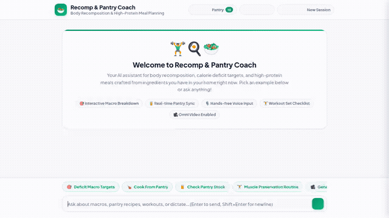

# 🏋️‍♂️🍳 Recomp & Pantry Coach

> An agentic fitness, body recomposition, and nutrition assistant built with Google Agent Development Kit (ADK) and Vertex AI Agent Engine.



---

## 📖 Overview

**Recomp & Pantry Coach** helps users achieve body recomposition—simultaneously shedding fat and building or preserving lean muscle tissue. 

Rather than prescribing generic diet templates or demanding impractical grocery lists, the coach calculates scientifically grounded **Mifflin-St Jeor macro and calorie deficit targets**, cross-references what ingredients users **already have in their home pantry and fridge**, and crafts high-protein culinary recipes with step-by-step cooking instructions and portion macros.

---

## ⚡ Key Capabilities

- **🎯 Precision Recomposition Calculations**: Uses the Mifflin-St Jeor formula to determine Basal Metabolic Rate (BMR), Total Daily Energy Expenditure (TDEE), target calorie deficits, and optimized protein (2.0–2.2g/kg), fat (0.8g/kg), and carbohydrate allotments.
- **🥫 Persistent Home Pantry Inventory**: Connects to Google Cloud Firestore to manage live ingredient stocks, quantities, and nutritional facts.
- **🍳 High-Protein Recipe Discovery**: Queries real culinary recipes via TheMealDB API, adapting them to match pantry stock while maintaining calorie deficit caps.
- **🧠 Cross-Session Conversational Memory**: Powered by Vertex AI Memory Bank to retain user body statistics, deficit goals, workout routines, and personal records across turns and conversations.
- **🖼️ AI Plated Dish Photography**: Employs `gemini-3.1-flash-lite-image` to generate appetizing plating previews of custom deficit meals, uploaded directly to Google Cloud Storage.
- **🎥 AI Demonstration Video Generation**: Leverages Google's Omni model (`gemini-omni-flash-preview`) in the global region to create short video guides for meals and training items, uploaded to Google Cloud Storage.
- **🪟 Agent-First UI (A2UI)**: Returns structured A2UI card payloads for clean visual presentation alongside conversational text.

---

## ☁️ Google Cloud Services & Architecture

| Layer | Service / Technology | Implementation Details |
|---|---|---|
| **Core Reasoning Agent** | **Vertex AI Agent Engine (Reasoning Engine)** | Scaffolded with `agents-cli` 1.4.0 (`agent_runtime`, `us-east1`) over the **Agent-to-Agent (A2A)** protocol, powered by `gemini-2.5-flash`. |
| **Long-Term Memory** | **Vertex AI Memory Bank** | `VertexAiMemoryBankService` wired via `PreloadMemoryTool` to inject past user context and `generate_memories_callback` to extract memories after each session. |
| **Structured Data** | **Google Cloud Firestore** | NoSQL database storing home pantry inventory items in the `recomp-pantry-items` collection. |
| **Media Hosting** | **Google Cloud Storage (GCS)** | Public storage bucket storing generated meal photos and Omni video clips with public HTTPS URLs. |
| **Image Generation** | **Gemini 3.1 Flash Lite Image** | Generates high-quality food photography from recipe prompts via Vertex AI, saved as ADK artifacts and uploaded to GCS. |
| **Video Generation** | **Gemini Omni Flash Preview** | Generates demonstration video clips using `client.interactions.create` on Vertex AI (`location="global"`). |
| **Search Grounding** | **Google Search Grounding** | Dedicated `search_agent` sub-agent equipped with `google_search` for real-time nutritional facts and exercise form checks. |
| **Rich Display UI** | **A2UI Protocol** | v0.8 BasicCatalog schema manager and `a2ui_callback` converting model outputs into structured UI cards. |
| **Web Frontend** | **FastAPI + Vanilla JS Chat UI** | Lightweight A2A proxy server rendering plain text, A2UI cards, an interactive Macro Visualizer bar, a slide-out pantry drawer, and dark/gym mode. |

---

## 🛠️ Implemented Agent Tools

All tools are implemented in Python in the `app/` directory and registered with `root_agent`:

| Tool Name | Source File | Description |
|---|---|---|
| `calculate_recomp_macros` | `app/recomp_tools.py` | Computes BMR, TDEE, deficit calories, and protein/carb/fat targets using the Mifflin-St Jeor equation. |
| `list_pantry_items` | `app/pantry_tools.py` | Reads all in-stock ingredients, quantities, and macro profiles from Firestore. |
| `get_pantry_item` | `app/pantry_tools.py` | Fetches details and nutritional breakdown for a specific ingredient from Firestore. |
| `add_or_update_pantry_item` | `app/pantry_tools.py` | Adds a new ingredient or updates quantity and macros in the Firestore pantry collection. |
| `remove_pantry_item` | `app/pantry_tools.py` | Deletes an ingredient from the Firestore pantry collection when consumed. |
| `search_public_recipes` | `app/recipe_tools.py` | Searches TheMealDB API for authentic recipes matching pantry ingredients. |
| `generate_meal_image` | `app/image_tools.py` | Generates a dish image with `gemini-3.1-flash-lite-image`, saves an ADK session artifact, and uploads to GCS. |
| `generate_meal_video` | `app/video_tools.py` | Generates a demonstration video with `gemini-omni-flash-preview`, saves an ADK session artifact, and uploads to GCS. |
| `PreloadMemoryTool` | `app/agent.py` | Preloads user memory facts from Vertex AI Memory Bank into the agent's turn context. |
| `AgentTool(search_agent)` | `app/agent.py` | Delegates real-time web search and nutritional verification to a specialized search agent. |

---

## 📋 Feature Status & Roadmap

To maintain strict project honesty, the table below outlines what is verified and operational in code versus planned future enhancements:

| Feature Area | Status | Notes |
|---|---|---|
| **Mifflin-St Jeor Macro & Deficit Math** | ✅ **Implemented** | Deterministic Python calculation for BMR, TDEE, and high-protein ratios. |
| **Firestore Pantry Database CRUD** | ✅ **Implemented** | Fully wired with live Firestore collection `recomp-pantry-items`. |
| **Cross-Session Memory Bank** | ✅ **Implemented** | Deployed with Vertex AI Memory Bank; remembers user body stats and PRs across sessions. |
| **Image & Video Generation** | ✅ **Implemented** | `gemini-3.1-flash-lite-image` and `gemini-omni-flash-preview` with GCS upload and artifact storage. |
| **A2UI Rich Cards & Frontend** | ✅ **Implemented** | Interactive macro visualizer, slide-out pantry drawer, workout checklists, dark mode, voice input. |
| **Public Recipe Grounding** | ✅ **Implemented** | Integrated via TheMealDB API. |
| **Isolated Code Execution Sandbox** | ⏳ *Planned, not yet implemented* | Calculations currently run via native Python tool functions rather than an external sandboxed container. |
| **USDA FoodData Central API** | ⏳ *Planned, not yet implemented* | Pantry items use Firestore-stored macro tables; direct USDA API integration is on the roadmap. |
| **Barcode & Receipt Computer Vision Scanning** | ⏳ *Planned, not yet implemented* | Camera-based pantry stocking is planned for future versions. |
| **Wearable Tracker Sync (Apple Health / Garmin)** | ⏳ *Planned, not yet implemented* | Activity levels are currently user-reported. |

---

## 💻 Local Setup & Run Guide

### Prerequisites
- Python 3.11+
- `uv` package manager (`curl -LsSf https://astral.sh/uv/install.sh | sh`)
- Google Cloud SDK (`gcloud`) authenticated to a GCP project with Vertex AI and Firestore enabled

### 1. Clone & Configure Environment

```bash
git clone <your-repo-url>
cd recomp-pantry-coach

# Authenticate with Google Cloud
gcloud auth application-default login
gcloud config set project <YOUR_GCP_PROJECT_ID>

# Set environment variables
export PROJECT_ID="<YOUR_GCP_PROJECT_ID>"
export GOOGLE_GENAI_USE_VERTEXAI="true"
export GOOGLE_CLOUD_PROJECT="<YOUR_GCP_PROJECT_ID>"
export GOOGLE_CLOUD_LOCATION="us-east1"
```

### 2. Run the Agent Locally via ADK Playground

```bash
# Install dependencies
uv sync

# Launch local ADK development playground
uv run agents-cli playground
```

### 3. Run the Web Frontend Locally

The web frontend includes a FastAPI proxy talking A2A and a chat UI with A2UI card support, dark gym mode, macro breakdown bar, and a slide-out pantry drawer:

```bash
cd frontend

# Set up virtual environment
python3 -m venv .venv
source .venv/bin/activate
pip install -r requirements.txt

# Specify your deployed Agent Engine resource or local agent directory
export AGENT_ENGINE_RESOURCE_NAME="projects/<PROJECT_NUMBER>/locations/us-east1/reasoningEngines/<ENGINE_ID>"
export AGENT_DIRECTORY="app"

# Start the local server
python main.py
```

Once started, navigate in your browser to the local port indicated by Uvicorn (default: port 8080).

---

## 📄 License

Apache License 2.0. See LICENSE for details.
